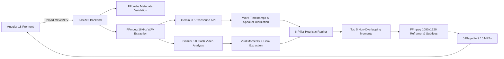

# ClipForge AI — AI-Powered Podcast Clipping Engine

ClipForge AI is a high-performance, full-stack application designed to transform 30-minute podcast videos into 5 professionally edited, high-engagement 9:16 vertical short-form videos with burned-in animated word subtitles.

---

## 1. System Architecture



---

## 2. Core Stack

| Component | Technology | Role |
|---|---|---|
| **Frontend** | Angular 18 (Standalone Components, Signals, Router, SCSS) | Modern Dark Purple/Indigo SaaS Dashboard, Video Player, Upload Manager |
| **Backend** | Python 3.12, FastAPI, Pydantic v2, SQLAlchemy (Async) | REST API, Media Ingestion, Background Pipeline Coordinator |
| **AI Intelligence** | Google Gen AI SDK (`google-genai` >= 3.2.0) | `gemini-3.5-transcribe` (word timestamps) & `gemini-3.8-flash` (moments) |
| **Video Engine** | FFmpeg 9.0.2 & FFprobe | Audio extraction, smart vertical framing (1080x1920), ASS subtitle burning |
| **Subtitles** | Advanced SubStation Alpha (`.ass`) | Word-by-word karaoke pop highlight animation, safe margin enforcement |
| **Database** | SQLite with `aiosqlite` (Async) / PostgreSQL ready | Job status tracking, transcript storage, clip candidate records |

---

## 3. Intelligent Clip Ranking Algorithm

Every candidate clip is scored using a 6-pillar weighted heuristic algorithm:
- **Hook Strength (25%)**: Sharpness and curiosity of opening 3 seconds
- **Emotional Impact (20%)**: Dynamic energy, sentiment shifts, controversy
- **Information Value (20%)**: Density of actionable takeaways
- **Standalone Context (15%)**: Self-contained coherence without prior context
- **Storytelling Quality (10%)**: Narrative arc and resolution
- **Ending Quality (10%)**: Punchy, memorable conclusion

Overlapping moments (>8s) are eliminated to guarantee 5 completely distinct short-form videos.

---

## 4. Quickstart Guide

### Prerequisites
- Python 3.11+ or 3.12+ (tested on Python 3.12.10)
- Node.js v18+ or v22+ (tested on Node v22.12.0)
- FFmpeg and FFprobe installed and available in system `PATH`

### 1. Backend Setup
```bash
# From repository root
cd backend
python -m venv venv

# On Windows:
venv\Scripts\activate
# On Linux/macOS:
source venv/bin/activate

pip install -r requirements.txt

# Configure environment variables (optional for local/test mode):
# Set your Gemini API key in .env or shell:
# export GEMINI_API_KEY="your_api_key_here"

# Start the FastAPI server (runs on port 8000)
python -m uvicorn backend.app.main:app --port 8000 --reload
```

### 2. Frontend Setup
```bash
# From repository root in a new terminal
cd frontend

npm install

# Start Angular development server (runs on port 4200 with proxy to backend)
npx ng serve --port 4200
```

Open your browser at **`http://localhost:4200`** to access the dashboard.

---

## 5. Automated Testing & Verification

The suite includes synthetic media generation tests to verify the end-to-end pipeline without needing external copyrighted video files:

```bash
# Run unit & video processing engine tests
$env:PYTHONPATH="."
backend\venv\Scripts\pytest backend\tests\test_pipeline.py -v

# Run full asynchronous end-to-end API integration test
backend\venv\Scripts\pytest backend\tests\test_api_integration.py -v
```

### Test Results:
- `test_ffprobe_metadata`: PASSED (accurate video resolution, duration, codec inspection)
- `test_audio_extraction`: PASSED (16kHz mono WAV extraction)
- `test_subtitle_generation`: PASSED (ASS format word-highlight generation)
- `test_clip_ranking_engine`: PASSED (6-pillar scoring and non-overlap pruning)
- `test_vertical_video_rendering`: PASSED (1080x1920 9:16 MP4 with burned subtitles)
- `test_full_api_workflow`: PASSED (Upload -> Ingestion -> Background Processing -> 5 Vertical MP4s -> Download validation)

---

## 6. Subtitle Styles & Video Reframing

ClipForge AI supports 3 distinct short-form typography styles:
1. **Bold Viral**: Yellow animated word pop with thick dark outlines, centered in mobile safe margins.
2. **Clean Minimal**: Modern sans-serif with subtle dark translucent backing pill.
3. **Podcast Pro**: Mint green speaker attribution, lower-third positioning.

### Reframing Strategies:
- **Smart Background Blur**: Dual-layer composition (blurred 1080x1920 background + sharp aspect-ratio preserved foreground).
- **AI Face Tracking Crop**: OpenCV frontal face detection tracks the primary speaker's center-of-mass across time and reframes directly into full 9:16 vertical view.
- **Center Crop**: Static center slice filling 1080x1920.

---

## 7. Interactive Clip Studio & Editor

Navigate to `/editor/:clipId` or click the Studio icon on any clip card to:
- Fine-tune start and end timestamps (with ±0.5s nudges)
- Switch subtitle styles dynamically
- Toggle between Smart Blur, Face Tracking, and Center Crop
- Re-render the 1080x1920 MP4 directly from the browser with live feedback!

---

## 7. Known Limitations & Cost Estimations

### Limitations:
- **CPU Rendering Speed**: Reframing 1080x1920 video with complex background blur filters and burned subtitles on CPU takes ~15–20 seconds per clip (approx. 1.5 minutes for 5 clips). For high-volume production, GPU acceleration (`h264_nvenc`) or a dedicated worker queue (Celery/Redis) is recommended.
- **Max Recommended Duration**: Configured by default for videos up to 60 minutes (2GB upload limit).

### Estimated Gemini API Costs (per 30-minute episode):
- **Audio Transcription (`gemini-3.5-transcribe`)**: ~$0.006 per minute = **~$0.18** per 30-min episode.
- **Multimodal Video Understanding (`gemini-3.8-flash`)**: Audio tokens + video frames = **~$0.04 to $0.08** per run.
- **Total AI Cost per 30-minute Podcast**: **~$0.22 to $0.26 USD** to produce 5 viral clips.
